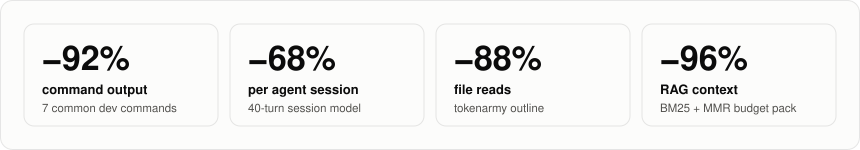
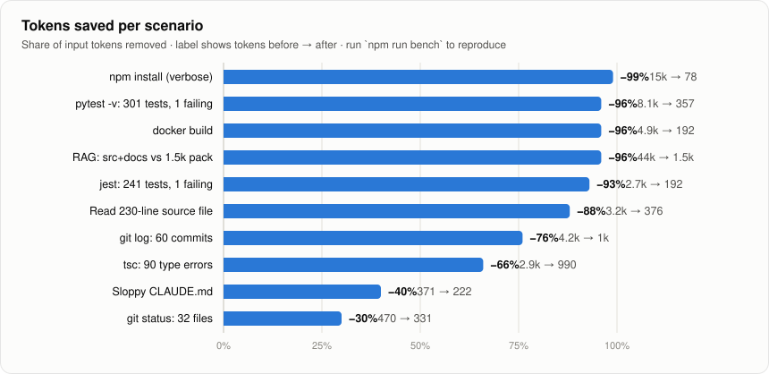
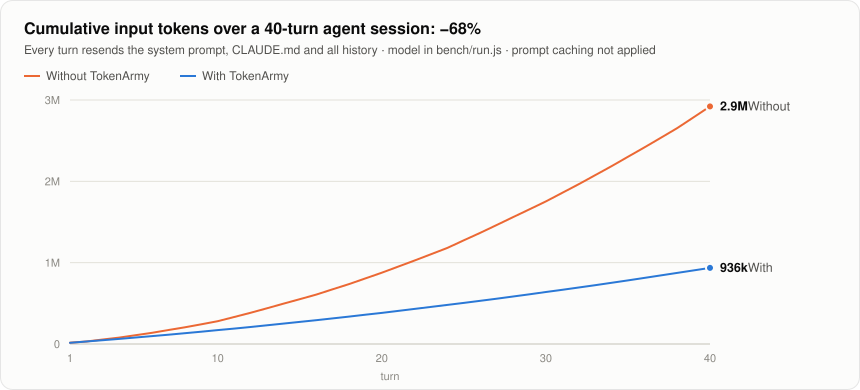
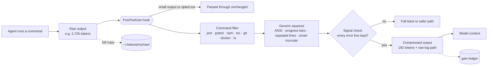

<div align="center">

# 🪖 TokenArmy

**Save tokens everywhere.** Compress tool output, strip AI slop, pack RAG context to a budget,<br>
and audit where your AI agent wastes context. Works with Claude Code, Codex, Cursor and any LLM.

[](LICENSE)
[](package.json)
[](package.json)
[](test/)

<picture>
  <source media="(prefers-color-scheme: dark)" srcset="assets/hero-dark.svg">
  
</picture>

[Quick start](#-quick-start) · [Before / after](#-before--after) · [Benchmarks](#-benchmarks) · [How it works](#-how-it-works) · [Commands](#-commands) · [Why TokenArmy](#-why-tokenarmy) · [Patterns](docs/PATTERNS.md)

</div>

---

## Why

In an agent loop, **every turn resends the entire history**. A 3,000-token test log on turn 3 of a 40-turn session is paid for 37 more times, about 110,000 input tokens for one command. Most of that log is passing tests, progress bars and download lines the model never needed.

TokenArmy removes that noise **at the source**, before it enters the context window. It never removes the errors, failures and file:line locations the agent needs.

Every number here says how it was measured, and `tokenarmy ab` lets you [measure it on your own project](#measure-it-on-your-own-project).

## ⚡ Quick start

**Claude Code plugin (one step):**

```
/plugin install tokenarmy --marketplace margesh10/TokenArmy
```

**Or from source (adds the CLI and the status line).** Pick one: with both the plugin and `init`, every hook runs twice.

```bash
git clone https://github.com/margesh10/TokenArmy && cd TokenArmy
npm link              # puts `tokenarmy` on your PATH (Node ≥ 18, no dependencies)

tokenarmy audit       # 1. find where this project leaks tokens
tokenarmy init --statusline   # 2. Claude Code: install the compression hook + live status line
                              #    (add --global for all projects)
tokenarmy gain        # 3. see what you saved
```

### 📟 Live status line

`--statusline` adds a line under Claude Code's prompt box that updates after every message:

```
Opus 5.5 · ctx 43.0k/1.00M (4%) · 182.0k in / 9.4k out · $0.87 · TokenArmy saved 3.0k tok (−94%, ≥$0.01)
```

| Part | Meaning |
|---|---|
| `ctx 43.0k/1.00M (4%)` | Context window currently in use |
| `182.0k in / 9.4k out` | Total tokens sent and received this session |
| `$0.87` | Session cost as Claude Code reports it. On a Pro/Max plan this is the API-price equivalent, not a charge |
| `TokenArmy saved …` | Tokens the hook removed **in this session**, valued at the model's input price |

The saved `$` is a lower bound (`≥`): a token kept out of context also isn't re-read on every later turn. Prices are Anthropic's list input rates (Opus 5.5 $4/M, Sonnet 5.5 $2/M, Haiku 5.5 $0.10/M, Fable 5.1 $10/M); set `TOKENARMY_PRICE_PER_MTOK` to use your own. Savings only grow when a Bash/PowerShell command prints a large output (≥ ~300 tokens that can be cut by ≥ 20%), so a fresh session shows `saved 0`. `tokenarmy gain` shows the all-time total. An existing custom `statusLine` in your settings is never replaced.

Using Codex, Cursor, Aider or Gemini CLI? Wrap noisy commands with `tokenarmy run -- <cmd>` and copy [`templates/AGENTS.md`](templates/AGENTS.md) into your project.

## 🔍 Before / after

A jest run with 241 tests, one of them failing. This is what your agent would otherwise read on every following turn:

<table>
<tr><th>Before: 299 lines · 2,725 tokens</th><th>After: 24 lines · 192 tokens (−93%)</th></tr>
<tr valign="top"><td>

```text
PASS src/auth/auth.test.ts (2.15 s)
  auth
    ✓ computes concurrent writes (28 ms)
    ✓ retries currency rounding (21 ms)
    ✓ returns empty input (10 ms)
    ✓ validates concurrent writes (29 ms)
    ✓ caches expired tokens (11 ms)
    … 15 more ✓ lines …
PASS src/billing/billing.test.ts
  … 11 more suites, 220 more ✓ lines …
FAIL src/checkout/total.test.ts
  ● checkout › total › applies discount…
    Expected: 107.1
    Received: 108.0
  …
Tests: 1 failed, 240 passed, 241 total
```

</td><td>

```text
[tokenarmy] 252 passing test lines hidden
FAIL src/checkout/total.test.ts
  checkout › total
    ✕ applies discount before tax (12 ms)

  ● checkout › total › applies discount before tax

    expect(received).toBe(expected)

    Expected: 107.1
    Received: 108.0

      42 |   const t = total(cart, {…});
    > 43 |   expect(t).toBe(107.1);
         |             ^
      at Object.<anonymous> (src/checkout/total.test.ts:43:13)

Test Suites: 1 failed, 12 passed, 13 total
Tests:       1 failed, 240 passed, 241 total
Time:        18.442 s
```

</td></tr>
</table>

The failure, the expected and received values, the code frame and the stack location all survive. The full raw output is saved to `~/.tokenarmy/raw/`, and its path is appended, so the agent can open it if it ever needs more.

<details>
<summary><b>More examples</b>: npm install, tsc, git log, CLAUDE.md</summary>

**`npm install` (verbose), 399 lines → 5 lines (−99%)**
```text
npm WARN deprecated inflight@1.0.6: This module is not supported, and leaks memory.
npm WARN deprecated glob@7.2.3: Glob versions prior to v9 are no longer supported
added 412 packages, and audited 413 packages in 21s
98 packages are looking for funding
2 moderate severity vulnerabilities
```

**`tsc --noEmit` with 90 errors, 92 lines → 7 lines (−66%).** Each message appears once, followed by every `file:line` location:
```text
error TS2322: Type 'string | undefined' is not assignable to type 'string'. (×30)
  src/orders/routes.ts:229, src/orders/service.ts:38, src/api/model.ts:94, …
error TS2532: Object is possibly 'undefined'. (×30)
  src/cart/routes.ts:117, src/billing/utils.ts:94, src/orders/utils.ts:62, …
```

**`git log`, 60 commits, 429 lines → 60 lines (−76%)**
```text
3b58b5b Oct 30 2026 Alex Chen: Add pagination to orders API
72d9ee8 Oct 29 2026 Priya Nair: Remove dead feature flag
```

**Sloppy `CLAUDE.md` (`tokenarmy compress --level 2`), −40%.** This file is sent with every request:
```diff
- Welcome! In today's fast-paced world of software development, it's important to note that following these guidelines is crucial.
+ Welcome! Following these guidelines is crucial.
- This project is a **robust**, **seamless**, cutting-edge e-commerce platform. We leverage TypeScript and utilize a wide range of tools in order to deliver a world-class experience.
+ This project is an e-commerce platform. We use TypeScript and use many tools to deliver an experience.
- - You must always run the tests before committing.
- - You must always run the tests before committing.
+ - Always run the tests before committing.
- - Please make sure to use "pnpm" instead of npm.
+ - Use "pnpm" instead of npm.
- - Due to the fact that we deploy on Fly.io, please make sure that you test with `fly deploy --dry-run`.
+ - Because we deploy on Fly.io, test with `fly deploy --dry-run`.
- Needless to say, code quality matters. Feel free to ask if anything is unclear. I hope this helps! Happy coding!
+ Code quality matters.
```

All inputs and outputs are in [`bench/fixtures/`](bench/fixtures) and [`bench/out/`](bench/out).
</details>

## 📊 Benchmarks

### Measure it on your own project

Savings depend on your work: sessions with verbose builds and installs, big test suites, long searches, large JSON responses, files read again after edits, and long sessions benefit most. `tokenarmy ab` runs the same task with TokenArmy **off** and **on** in throwaway copies of your project, interleaved, and reports billed tokens (from Claude's own transcripts), cost, turns and success rate. A run only counts if your check command passes. See [`bench/ab/example.json`](bench/ab/example.json).

<!-- REAL_TASK_RESULTS: add measured A/B results here once published -->

### Fixture benchmarks: what one filter does to one output

These measure a single command's output before and after, on synthetic but realistic fixtures. They show what each filter can do. **They are not per-session savings**: a real session mixes compressible output with everything else.

<picture>
  <source media="(prefers-color-scheme: dark)" srcset="assets/savings-dark.svg">
  
</picture>

| Scenario | Tool | Before | After | Saved |
|---|---|---:|---:|---:|
| `npm install` (verbose) | hook / `run` | 14,625 | 78 | **99%** |
| `pytest -v`: 301 tests, 1 failing | hook / `run` | 8,091 | 357 | **96%** |
| `docker build` | hook / `run` | 4,902 | 192 | **96%** |
| `jest`: 241 tests, 1 failing | hook / `run` | 2,725 | 192 | **93%** |
| RAG: `src/` + `docs/` vs a 1.5k-token pack | `pack` | 37,343 | 1,535 | **96%** |
| Reading a 230-line source file | `outline` | 3,213 | 376 | **88%** |
| `git log`: 60 commits | hook / `run` | 4,173 | 1,010 | **76%** |
| `tsc`: 90 type errors (all locations kept) | hook / `run` | 2,920 | 990 | **66%** |
| Sloppy `CLAUDE.md` | `compress` | 371 | 222 | **40%** |
| `git status`: 32 files | hook / `run` | 470 | 331 | **30%** |

### A model of how savings compound (a model, not a measurement)

<picture>
  <source media="(prefers-color-scheme: dark)" srcset="assets/session-dark.svg">
  
</picture>

Without compression, total input grows **quadratically**, because every command's output is resent on every later turn. With TokenArmy the curve stays close to linear. This *model* assumes every other turn runs an uncompressed noisy command, and gives **2.92M → 937k input tokens (−68%)**. Real sessions have far fewer noisy outputs than that; see the A/B above for measured numbers.

> **About these numbers.** The fixtures are synthetic but shaped like real tool output, and generated deterministically, so `npm run bench` reproduces every figure on any machine. Token counts use TokenArmy's built-in estimator (within ±15% of real BPE tokenizers). The session model assumes a 15k-token system prompt plus tool definitions, a command every second turn and no prompt caching. Caching lowers the *price* of a resent prefix, but not the context-window space it takes. Measure your own work with `tokenarmy gain` and Claude Code's `/context`.

## 🧠 How it works



Nine layers, each targeting a different place tokens leak:

| Layer | Where tokens leak | TokenArmy |
|---|---|---|
| **Tool output** | Tests, installs, builds, git: resent every turn | PostToolUse hook on Bash/PowerShell, `run`, `squeeze`. Filters for test runners, installs, tsc/eslint, ruff/flake8 (grouped by rule), cargo/maven/gradle progress, docker build, `git status/log/diff/push/pull`, `docker ps`/`kubectl get` (unhealthy rows first) |
| **JSON output** | `curl`, `gh api`, `kubectl -o json`, `aws`: hundreds of near-identical objects | Arrays of objects become one header + rows; long arrays/strings trimmed with counts; items mentioning errors always shown |
| **Retry loops** | Re-running the same failing command | From the 3rd identical failure in a session, a one-line note tells the agent to change approach |
| **Search output** | Hundreds of grep/rg hits, minified lines | Grep tool + grep/rg/Select-String grouped by file with counts; error hits always shown |
| **File re-reads** | Reading the same file again after an edit | Unchanged → a one-line note; changed → only the diff. Reset at every compaction |
| **Compaction** | The summary loses exact files, asks and todos | PreCompact checkpoint, handed back verbatim by SessionStart |
| **Memory files** | `CLAUDE.md` / `AGENTS.md`: sent with every request | `compress`, `slop --fix`, [`templates/`](templates) |
| **File reads** | Reading 2,000 lines to change 3 | `outline`, Read-deny rules for lock, log and dist files |
| **Retrieval** | Top-k chunks full of near-duplicates | `pack` (structure-aware chunks → BM25 → MMR → token budget) and `graph` (import-graph neighbourhood) |
| **Setup** | MCP schemas, skill descriptions, cache-busting timestamps | `audit` |

Plus a terse-output skill, [`skills/tokenarmy/SKILL.md`](skills/tokenarmy/SKILL.md), for the model's own replies.

### 🔁 It learns from your sessions (locally)

- **It notices when it cut too much.** If the agent opens a raw log TokenArmy saved, that compression hid something it needed. Command families the agent keeps expanding are automatically left alone from then on.
- **It learns your noise.** `tokenarmy learn` finds lines that repeat across your saved outputs and never carry errors, and proposes filters; `--write` saves them to `~/.tokenarmy/filters.json`. Add your own per project in `.tokenarmy/filters.json`:

```json
{ "rules": [{ "name": "deploy-noise", "cmd": "deploy", "drop": ["^uploading chunk"] }],
  "bypass": ["^make\\b"] }
```

Filter rules can never drop an error or failure line. Everything stays on your machine.

## 🧰 Commands

| Command | What it does |
|---|---|
| `tokenarmy audit [dir]` | Lists token leaks in a project or agent setup, with fixes and estimated savings |
| `tokenarmy init [--global] [--skill] [--statusline]` | Installs the Claude Code hook (plus the terse-mode skill and the [live status line](#-live-status-line)) and backs up your settings first |
| `tokenarmy statusline` | Renders the status line from Claude Code's JSON on stdin (used by `init --statusline`) |
| `tokenarmy run -- <cmd>` | Runs any command and prints compressed output. Works with any agent |
| `tokenarmy squeeze [file] --cmd "<cmd>"` | Compresses saved output or piped stdin |
| `tokenarmy compress <file> --level 1\|2\|3 [--write]` | Compresses prompts or memory files (code, URLs and quoted strings are never changed) |
| `tokenarmy slop <file> [--fix]` | Scores AI slop per 100 words and removes it |
| `tokenarmy outline <file>` | Signatures-only skeleton of a code file |
| `tokenarmy pack <dir> --query "…" --budget N` | Retrieval packed under a hard token budget |
| `tokenarmy graph <dir> --seed <file>` | Related files by import hops (graph-RAG for code) |
| `tokenarmy count [file]` · `gain` | Estimates tokens · shows your local savings ledger |
| `tokenarmy expand [id]` | Prints a saved raw output (the latest if no id) |
| `tokenarmy learn [--write]` | Shows auto-bypassed commands and proposes noise filters mined from your raw logs |
| `tokenarmy ab <config.json>` | Controlled A/B on a real task: TokenArmy off vs on, interleaved, billed tokens from transcripts, success checked. Example: [`bench/ab/example.json`](bench/ab/example.json) |

## 🛡️ Safe by design

- **Never rewrites or auto-approves commands.** It compresses *after* the command runs and never returns `permissionDecision`, so your permission prompts stay exactly as they are.
- **Recoverable.** Every compressed output keeps a full raw copy on disk, and its path goes into the output.
- **Errors are never dropped.** Lines with error, fail, panic, traceback, assert and similar words always survive. If a filter would lose one, it falls back to the generic compressor.
- **Code is never changed.** Slop removal and prompt compression mask fenced code, inline code, URLs and quoted strings first.
- **Respects the agent's choices.** If a command already narrows its output (`| tail`, `| grep`, `sed -n`, `Select-Object -First`…), only lossless cleanup is applied: colour codes and carriage-return spam go, no lines are cut.
- **Re-reads are conservative.** A re-read is only shortened when the same agent read the same range of the same file within the last 20 minutes and no compaction has happened since. Reading with an explicit `limit` always returns the full file.
- **Easy to skip.** Add `# raw` to a command, set `TOKENARMY_OFF=1`, or turn off one layer: `TOKENARMY_READ_DEDUPE=0`, `TOKENARMY_SEARCH=0`, `TOKENARMY_JSON=0`, `TOKENARMY_LOOPGUARD=0`, `TOKENARMY_CHECKPOINT=0`.
- **Local only.** No network calls and no telemetry. The savings ledger is a local JSONL file.

## 💪 Why TokenArmy

1. **The command you approve is the command that runs.** TokenArmy never rewrites or wraps a command. It only shrinks the *output* after the command has run, never returns a permission decision, and if the hook ever fails the agent simply gets the original output.
2. **Nothing sits between you and the API.** Plain Claude Code hooks: no proxy, no network calls, no background process, no telemetry. Your traffic goes exactly where it went before.
3. **It never hides an error.** Error, failure, panic, traceback and assertion lines survive every filter, built-in or learned. Items in JSON and rows in tables that mention a failure are always shown, even past the cut-off.
4. **It knows when to back off.** If the agent already narrowed a command (`| tail -40`, `| grep`), no lines are cut. If the agent keeps opening the raw output of some command, TokenArmy stops compressing that command by itself.
5. **Nothing is lost.** Every compressed output keeps a full raw copy on disk, its path is in the output, and `tokenarmy expand` prints it back.
6. **Covers the whole session, not just command output.** Command output, search results, JSON responses, file re-reads, retry loops and compaction, plus `audit`, memory-file compression, slop removal, budgeted RAG `pack`, import `graph` and a live cost status line, in one tool.
7. **It learns from you, locally.** It notices which compressions you needed to undo and which noise repeats in your projects, and adapts. Nothing leaves your machine.
8. **Measure it yourself.** `tokenarmy ab` runs your own task with TokenArmy off and on, in throwaway copies of your project, and reports billed tokens and success rate from Claude's own transcripts, run-to-run noise included.
9. **Small enough to read, free to use.** MIT, about 2,500 lines of dependency-free Node. You can audit all of it in an afternoon. Works the same on Windows PowerShell as on bash.

## 🗺️ Roadmap

- [x] Per-turn file diffs: send only what changed since the agent last read a file
- [x] Compaction checkpoint (PreCompact + SessionStart)
- [x] Grep / search compression
- [x] Local learning loop (auto-bypass, mined filters)
- [x] Claude Code plugin
- [x] `tokenarmy ab`: reproducible real-task benchmark
- [ ] Publish to npm (`npm i -g tokenarmy`)
- [ ] A/B results on more public projects (noisy builds, large monorepos, long sessions)
- [ ] Filters for `cargo test`, `go test`, `mvn`, `gradle` and `terraform plan`
- [ ] Optional exact token counts via a real tokenizer when one is installed
- [ ] Codex and Gemini CLI native hooks

## 📚 Learn more

[**docs/PATTERNS.md**](docs/PATTERNS.md) covers the session cost model, prompt caching, context budgets, RAG that retrieves less, graph engineering for code, prompt and loop patterns, and what's coming next.

## 🤝 Contributing

PRs welcome, especially new command filters with real-world fixtures. See [CONTRIBUTING.md](CONTRIBUTING.md). Run `npm test` and `npm run bench` before opening one.

## License

MIT © 2026 **Margesh**.
